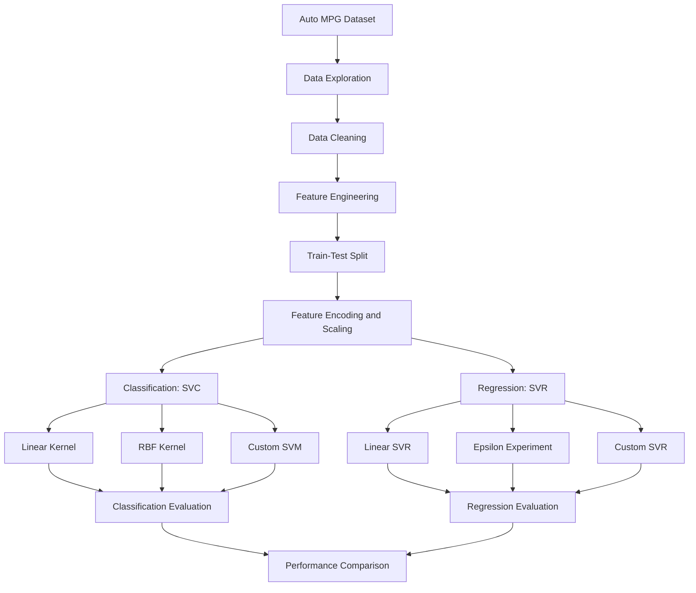
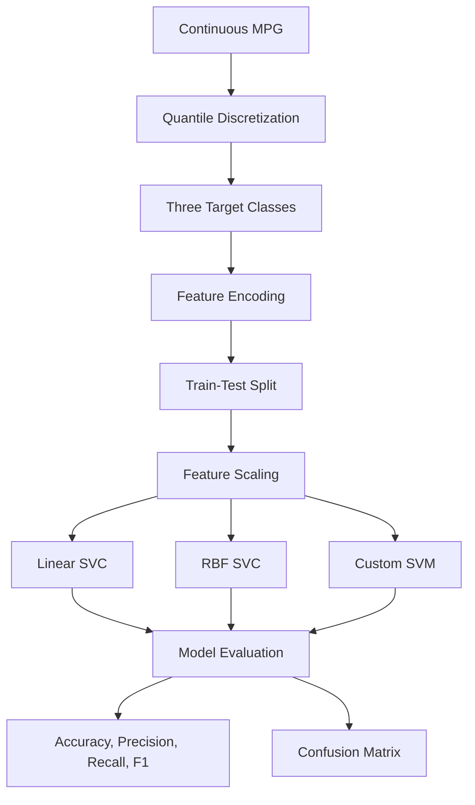
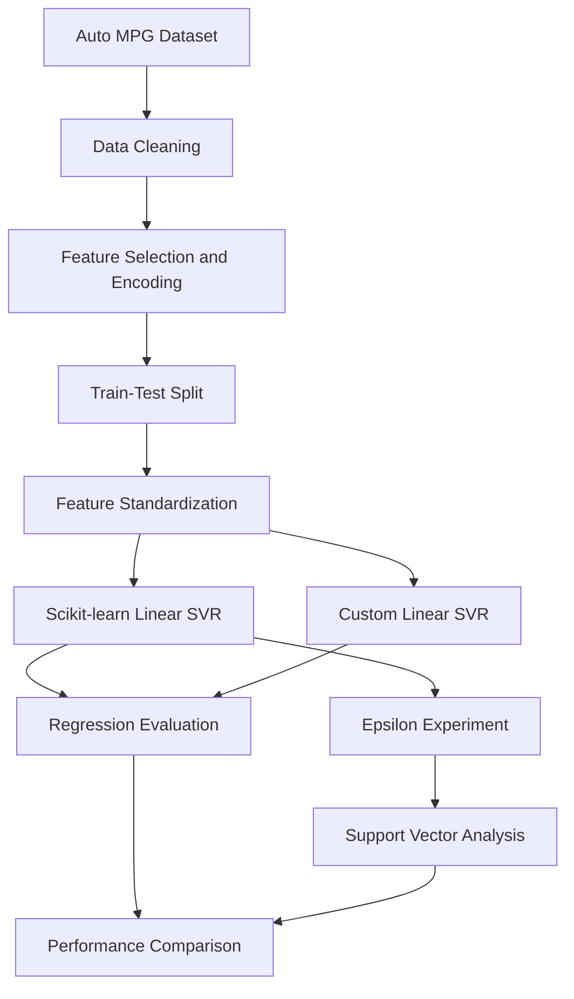

# Support Vector Machines for Fuel Efficiency Prediction

<p align="center">
  <strong>Auto MPG Dataset | Classification & Regression</strong>
  <br>
  <sub>Machine Learning Academic Project</sub>
</p>

<p align="center">
  Prepared by <strong>OUARAGHOUANE Nour El Houda <strong>
  <br>
  Master in Data Engineering and Artificial Intelligence
</p>

<p align="center">
  
  
  
  
</p>

---

## 1. Project Overview

This project explores **Support Vector Machines (SVM)** for modeling vehicle fuel efficiency using the Auto MPG dataset.

The main objective is to investigate two complementary machine learning approaches:

- **Support Vector Classification (SVC):** Transforming the continuous MPG target into three discrete categories and predicting the corresponding fuel-efficiency class.
- **Support Vector Regression (SVR):** Predicting continuous MPG values using Support Vector Regression and investigating the influence of the epsilon-insensitive loss parameter.

Both approaches include implementations using Scikit-learn as well as custom implementations developed from scratch.

The project emphasizes the mathematical foundations of SVMs, data preprocessing, optimization strategies, model evaluation, and experimental comparison.


## 2. Project Objectives

The main objectives are:

- Understand the mathematical principles behind Support Vector Machines.
- Implement linear and non-linear SVM classification.
- Explore multiclass classification using the One-vs-Rest strategy.
- Understand and implement Support Vector Regression.
- Investigate the influence of epsilon on support vectors and regression performance.
- Develop custom SVM implementations without relying on Scikit-learn estimators.
- Compare custom implementations with established Scikit-learn models.
- Interpret experimental results and identify model limitations.

## 3. Project Architecture

The project follows a structured machine learning workflow, from dataset exploration to model evaluation.



---

# Part I — Dataset and Preprocessing

## 4. Dataset Description

The project uses the **Auto MPG dataset**, obtained through Seaborn.

```python
import seaborn as sns

df = sns.load_dataset("mpg")
```

### Dataset characteristics

| Property | Description |
|---|---|
| Original observations | 398 |
| Observations after cleaning | 392 |
| Original columns | 9 |
| Missing values | 6 in horsepower |
| Target variable | mpg |
| Numerical features | 6 |
| Categorical features | 1 |

The `name` column is excluded from the models.

### Features

| Feature | Description |
|---|---|
| cylinders | Number of engine cylinders |
| displacement | Engine displacement |
| horsepower | Engine power |
| weight | Vehicle weight |
| acceleration | Vehicle acceleration |
| model_year | Vehicle model year |
| origin | Vehicle origin |

**Target variable — MPG**

MPG (Miles Per Gallon) measures the distance a vehicle can travel using one gallon of fuel.

A higher MPG value indicates better fuel efficiency and lower fuel consumption for a given distance.

## 5. Data Preprocessing

The following preprocessing operations are applied:

1. **Missing value removal:** Remove the six observations containing missing horsepower values.
2. **Feature selection:** Exclude the vehicle name and separate the target variable.
3. **Categorical encoding:** Apply One-Hot Encoding to the `origin` feature.
4. **Data splitting:** Divide the dataset into training and testing sets using an 80/20 ratio and `random_state=42`.
5. **Feature standardization:** Apply StandardScaler, fitting it exclusively on the training data before transforming both sets.

Feature standardization is particularly important for SVM because the algorithm relies on distances and margins. Features with larger numerical scales could otherwise dominate the optimization process.

---

# Part II — Support Vector Classification

## 6. Classification Objective

The original MPG variable is continuous. To formulate a classification problem, it is transformed into three categories representing different levels of fuel efficiency.

### Target discretization

Quantile-based discretization (terciles) is used to divide the MPG distribution into three approximately balanced classes.

| Class | MPG interval | Interpretation |
|---|---|---|
| Low | MPG ≤ 18.5 | High fuel consumption |
| Medium | 18.5 < MPG ≤ 27 | Medium fuel consumption |
| High | MPG > 27 | Low fuel consumption |

This approach creates relatively balanced classes while preserving the ordering of fuel-efficiency levels.

The thresholds are dataset-dependent rather than predefined engineering standards.

## 7. Classification Workflow



## 8. Classification Models

### 8.1 Scikit-learn implementations

Two SVC configurations are investigated:

| Model | Kernel | Purpose |
|---|---|---|
| Linear SVC | Linear | Linear decision boundaries |
| RBF SVC | Radial Basis Function | Non-linear decision boundaries |

The RBF kernel allows the classifier to model more complex decision boundaries by implicitly mapping observations into a higher-dimensional feature space.

### 8.2 Custom SVM implementation

Custom implementations are developed to explore the underlying optimization process.

The implementation includes:

- Hinge loss and gradient-based optimization for linear classification.
- One-vs-Rest strategy for multiclass classification.
- An experimental custom RBF implementation.

These implementations provide a deeper understanding of the mathematical operations behind SVM classification without relying on Scikit-learn's SVC estimator.

## 9. Classification Results

The following table summarizes the experimental accuracy obtained by the different models.

| Model | Accuracy |
|---|---:|
| Scikit-learn SVC — Linear | **79.75%** |
| Scikit-learn SVC — RBF | 78.48% |
| Custom Linear SVM | 75.95% |
| Custom RBF SVM | 69.62% |

### Results Analysis

Several observations can be drawn from the experiment:

- The linear SVC achieves the highest accuracy among the tested classifiers.
- The RBF kernel performs slightly below the linear kernel, suggesting that additional non-linearity does not necessarily improve performance on this dataset.
- The custom linear implementation achieves reasonably close results to Scikit-learn.
- The custom RBF implementation presents a larger performance gap, highlighting the limitations of the current optimization procedure.

These results suggest that a simpler linear decision boundary can be competitive for this classification task.

---

# Part III — Support Vector Regression

## 10. Regression Objective

Unlike classification, regression preserves the continuous nature of the MPG target.

The objective is to predict the numerical fuel-efficiency value of a vehicle rather than assigning it to a predefined category.

A linear Support Vector Regressor is used to investigate the relationship between vehicle characteristics and fuel efficiency.

### 10.1 Epsilon-insensitive loss

A fundamental concept in Support Vector Regression is the epsilon-insensitive loss function.

$$
L_\epsilon(y,\hat{y}) =
\max(0, |y-\hat{y}|-\epsilon)
$$

Where:

- \(y\) represents the actual target value.
- \(\hat y\) represents the predicted value.
- \(\epsilon\) defines the tolerance margin.

The loss function ignores prediction errors that fall within the epsilon-wide tolerance zone. Only deviations exceeding this margin contribute to the loss.

### 10.2 SVR Optimization Objective

The standard primal optimization objective for linear epsilon-SVR can be expressed as:

\[
\min_{w,b,\xi,\xi^*}
\frac{1}{2}\|w\|^2
+
C\sum_{i=1}^{n}(\xi_i+\xi_i^*)
\]

Subject to:

\[
y_i-(w^Tx_i+b)\leq\epsilon+\xi_i
\]

\[
(w^Tx_i+b)-y_i\leq\epsilon+\xi_i^*
\]

\[
\xi_i,\xi_i^*\geq 0
\]

The regularization parameter \(C\) controls the trade-off between model complexity and prediction errors outside the epsilon-insensitive tube.

## 11. Regression Workflow



## 12. Scikit-learn SVR Implementation

The baseline regression model uses a linear kernel with the following configuration:

```python
SVR(
    kernel="linear",
    C=1.0,
    epsilon=0.1
)
```

### Evaluation Metrics

The model is evaluated using four regression metrics:

| Metric | Result |
|---|---:|
| MAE | 2.379 |
| MSE | 11.321 |
| RMSE | 3.365 |
| R² | **0.778** |

### Interpretation

The model achieves an R² score of 0.778, indicating that approximately 77.8% of the variance in the test-set MPG values is explained by the model.

The RMSE of 3.365 indicates the typical magnitude of prediction errors, expressed in MPG, with greater sensitivity to larger errors.

## 13. Influence of Epsilon

An experiment is conducted using different epsilon values to investigate their influence on regression performance and the number of support vectors.

### Experimental Results

| Epsilon | MAE | RMSE | R² | Support Vectors |
|---:|---:|---:|---:|---:|
| 0.1 | 2.379 | 3.365 | 0.778 | 304 |
| 0.5 | 2.352 | 3.352 | 0.780 | 272 |
| 1.0 | 2.371 | 3.364 | 0.778 | 229 |
| 2.0 | 2.383 | 3.278 | **0.790** | 157 |
| 5.0 | 2.521 | 3.328 | 0.783 | 38 |

### Results Analysis

The experiment highlights several important observations:

- Increasing epsilon generally reduces the number of support vectors in the tested configurations.
- A wider epsilon-insensitive tube allows the model to tolerate larger prediction deviations without penalizing them.
- Epsilon = 2 achieves the highest R² and the lowest RMSE.
- Epsilon = 0.5 produces the lowest MAE.
- A larger epsilon can simplify the model by reducing the number of support vectors, but may also reduce its sensitivity to certain prediction errors.

The results demonstrate that epsilon influences both model complexity and predictive performance.

Importantly, the optimal epsilon depends on the evaluation metric being considered.

## 14. Custom SVR vs Scikit-learn

A custom linear SVR implementation is developed using gradient-based optimization.

The purpose is to understand the optimization process behind Support Vector Regression and compare the resulting predictions with an established implementation.

### Performance Comparison

| Metric | Custom SVR | Scikit-learn SVR |
|---|---:|---:|
| MAE | 3.419 | **2.379** |
| MSE | 21.342 | **11.321** |
| RMSE | 4.620 | **3.365** |
| R² | 0.582 | **0.778** |

### Discussion

Scikit-learn achieves better performance across all reported regression metrics.

The difference highlights the importance of optimization strategies, convergence, and numerical implementation in Support Vector Regression.

Although the custom implementation does not achieve the same predictive performance, it provides practical insight into the algorithm's underlying mechanics.

---

# Part IV — Evaluation and Discussion

## 15. Visual Analysis

The notebooks provide visual and numerical analyses to better understand model behavior.

The main visualizations include:

**Classification**
- MPG distribution and discretization thresholds.
- Confusion matrices.
- Classification performance reports.

**Regression**
- Epsilon versus number of support vectors.
- Regression performance metrics.
- Actual versus predicted MPG.
- Residual analysis.

The regression plots should be included in the notebook before claiming them as completed visualizations in the final repository.

## 16. Technologies and Libraries

| Technology | Purpose |
|---|---|
| Python | Main programming language |
| NumPy | Numerical computation |
| Pandas | Data manipulation |
| Seaborn | Dataset loading and visualization |
| Matplotlib | Data visualization |
| Scikit-learn | Reference models and evaluation |
| Jupyter Notebook | Interactive experimentation |

---

# Part V — Repository Information

## 17. Repository Structure

```text
svm-auto-mpg/
│
├── notebooks/
│   ├── svm_classification.ipynb
│   └── svm_regression.ipynb
│
├── README.md
└── requirements.txt
```

## 18. Installation and Usage

### Prerequisites

- Python 3.x
- pip
- Jupyter Notebook

### 1. Clone the repository

```bash
git clone https://github.com/YOUR_USERNAME/svm-auto-mpg.git

cd svm-auto-mpg
```

### 2. Install dependencies

```bash
pip install -r requirements.txt
```

### 3. Launch Jupyter Notebook

```bash
jupyter notebook
```

### 4. Run the experiments

Open the notebooks:

- `svm_classification.ipynb`
- `svm_regression.ipynb`

Execute the cells sequentially to reproduce the experiments.

The dataset is loaded through Seaborn and may require an internet connection for its initial download.

---

## 19. Limitations and Future Improvements

Although the experiments provide useful insights into SVM classification and regression, several improvements remain possible:

- Apply cross-validation for more reliable model evaluation.
- Perform systematic hyperparameter tuning for C, epsilon, and kernel parameters.
- Implement a mathematically rigorous kernel SVM optimizer such as Sequential Minimal Optimization (SMO).
- Improve convergence and optimization in the custom SVR implementation.
- Investigate additional kernel functions.
- Use Scikit-learn Pipelines and ColumnTransformer to organize preprocessing.
- Add learning curves and more detailed residual analysis.

These improvements could provide a more comprehensive evaluation of the models and their generalization capabilities.

## 20. Conclusion

This project investigates Support Vector Machines through two complementary machine learning tasks: classification and regression.

The classification experiments demonstrate the effectiveness of linear and non-linear decision boundaries, while the regression experiments highlight the influence of the epsilon-insensitive loss parameter on prediction performance and model complexity.

Implementing custom versions of SVM provides a deeper understanding of the mathematical and computational principles underlying these algorithms.

Finally, comparing custom implementations with Scikit-learn demonstrates the practical importance of optimization strategies and numerical stability in machine learning.

---

## Author

**OUARAGHOUANE Nour El Houda**

Master's Student in Data Engineering and Artificial Intelligence

Machine Learning | Data Science | Artificial Intelligence

[GitHub Profile](https://github.com/nourmiyy03)

---

<p align="center">
  <sub>Understanding the mathematics. Implementing the algorithms. Evaluating the results.</sub>
</p>
